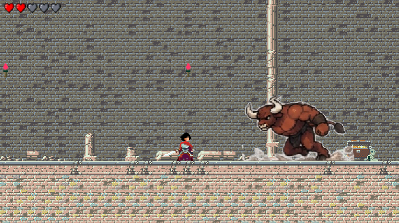
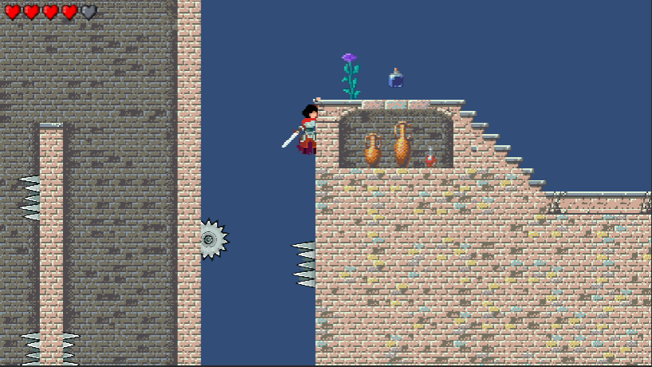

# Labyrinth's End

A 2D action platformer built in Unity as my first personal project, made to learn game development. Fight your way through enemies and traps, unlock new abilities, and defeat the Minotaur.

## Play

| Platform | Download |
|---|---|
| Windows | [Download (.rar)](https://github.com/MehrdadMasoudi/1stProject-Platformer/releases/download/v1.0.0/Labyrinth.s.End.-.Windows.rar) |
| Android | [Download (.apk)](https://github.com/MehrdadMasoudi/1stProject-Platformer/releases/download/v1.0.0/LabyrinthsEnd.-.Android.apk) |

**Gameplay video:**

[Watch on YouTube](https://youtu.be/kF4wdP2c-AM)

## Screenshots

## Run from source

1. Install **Unity 6000.5.7f1** through Unity Hub.
2. Clone this repository and open the project folder in Unity Hub.
3. Open `Assets/Scenes/MainMenu.unity` and press **Play**.

To run the automated tests, open **Window > General > Test Runner** in Unity and run the EditMode and PlayMode tests.

## Assets Used
- **Art assets:** Luis Zuno ([@ansimuz](https://www.patreon.com/ansimuz)), [Arsule](https://arsule.itch.io/), [Ibrahimart](https://ibrahimart.itch.io/), [Game Developer Studio](https://www.gamedeveloperstudio.com/), [Surt (OpenGameArt)](https://opengameart.org/users/surt)
- **Mobile control icons:** [Kenney](https://www.kenney.nl)
- **Sword sounds:** StarNinjas
- **Music:** [Pascal Belisle](https://soundcloud.com/thetoadz)
- **Font:** [Craftron Gaming](https://www.dafont.com/craftron-gaming.d6128)
- **Minotaur and hooded rogue sprites:** AI-generated

## License

Code: [MIT](LICENSE).

Art, music, and sound effects belong to their original creators and retain their respective licenses. See [Assets used](#assets-used).
